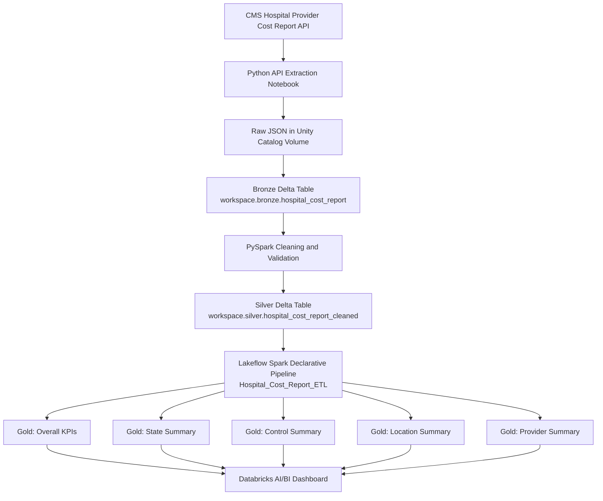

# Project Architecture

**Pipeline scope:** The Lakeflow pipeline reads the already-prepared Silver table and produces the five Gold dashboard outputs. API extraction and Silver preparation are performed in separate notebooks.
